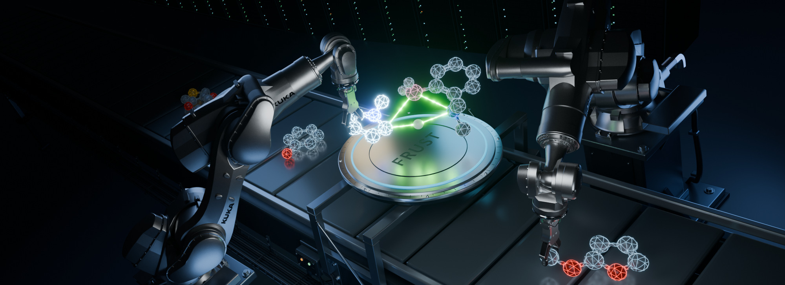
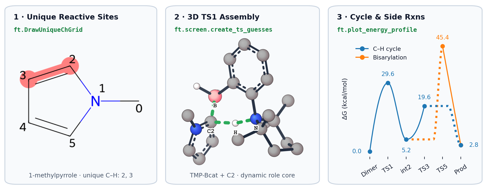

<div align="center">



# FRUST

**Automated Frustrated Lewis Pair (FLP) catalyst & substrate screening — 3D transition-state assembly and multi-level g-xTB / UMA / DFT workflows**

<p align="center">
  <a href="https://doi.org/10.1039/d6sc04421b"></a>
  <a href="https://molindiscovery.github.io/FRUST/"></a>
  <a href="https://github.com/molindiscovery/FRUST/actions/workflows/docs.yml"></a>
  <a href="https://www.python.org/">=3.10"></a>
  <a href="LICENSE"></a>
  <a href="https://docs.astral.sh/ruff/"></a>
</p>

<p align="center">
  <a href="#quickstart"><b>Quickstart</b></a> ·
  <a href="#highlights"><b>Highlights</b></a> ·
  <a href="#installation"><b>Installation</b></a> ·
  <a href="https://molindiscovery.github.io/FRUST/"><b>Documentation</b></a> ·
  <a href="#how-to-cite"><b>Cite</b></a>
</p>

<sub><i>3D artwork created in Blender illustrating automated FLP transition-state screening on HPC — accompanying our Edge Article in <a href="https://doi.org/10.1039/d6sc04421b">Chemical Science (2026)</a>.</i></sub>

</div>

---

**FRUST** turns candidate **B–aryl–N Frustrated Lewis Pair (FLP)** catalyst and substrate SMILES into validated free-energy barriers (`ΔG‡`) for metal-free C–H borylation. It maps symmetry-unique C–H sites, assembles constrained 3D transition states (`TS1`–`TS8`), and funnels conformers through staged `g-xTB`, Meta `UMA`, and `ORCA` DFT calculations.

<p align="center">
  <picture>
    <source media="(prefers-color-scheme: dark)" srcset="docs/assets/readme/pipeline-showcase-dark.png">
    
  </picture>
</p>

<p align="center">
  <sub>Explore interactive 3D conformer ensembles, transition-state cores, and imaginary vibrational modes in the <a href="https://molindiscovery.github.io/FRUST/visualization/overview/">online visualization guide</a>.</sub>
</p>

## Highlights

- **Combinatorial FLP screens** — Cross candidate B–aryl–N catalysts (including stereoisomers and resting-state dimers) with target substrates from one CSV.
- **Role-based 3D TS assembly (`tsguess2`)** — Build productive C–H borylation (`TS1`–`TS4`) and competing bisarylation (`TS5`–`TS8`) cores dynamically without hardcoded atom indices.
- **Composable `g-xTB` → `UMA` → `DFT` funnels** — Swap conformer screening, `ALPB`/`SMD` solvent reranking, and `OptTS` + Hessian validation presets without changing target definitions.
- **Campaign-local references** — Calculate each required dimer, free substrate, HBpin, or H₂ target once per campaign and trace barriers to the exact results used.
- **Laptop-to-Slurm parity** — Preview state graphs with `wf.plan()`, smoke-test locally with `wf.run(debug=True)`, and submit Slurm job arrays with `wf.submit(array=True)`.

## Quickstart

### 1. Try Locally in 60 Seconds (Python + RDKit Only)

Map symmetry-unique C–H sites and build constrained 3D FLP transition-state guesses right after `pip install -e .` (no external QM binaries needed):

```python
import frust as ft

# Highlight symmetry-unique aromatic C-H indices from SMILES
ft.DrawUniqueChGrid(["CN1C=CC=C1", "COC1=CC=CO1"])

# Expand candidate catalysts x substrates and assemble 3D TS guesses (tsguess2)
components = ft.screen.read("docs/examples/screen.csv")
systems = ft.screen.expand(components)
ts_guesses = ft.screen.create_ts_guesses(
    systems.iloc[:1],
    ts_types=["TS1", "TS2", "TS4"],
    n_confs=2,
)

ts_guesses["TS1"][["substrate_name", "catalyst_name", "rpos", "cid", "tsguess_backend"]]
```

```text
     substrate_name catalyst_name  rpos  cid tsguess_backend
0  n_methyl_pyrrole      tmp_bcat     2    0        tsguess2
1  n_methyl_pyrrole      tmp_bcat     2    1        tsguess2
2  n_methyl_pyrrole      tmp_bcat     3    0        tsguess2
3  n_methyl_pyrrole      tmp_bcat     3    1        tsguess2
```

### 2. Multi-Level Catalyst & Substrate Screen

Compose conformer screening, UMA reranking, catalyst-dimer / reagent references, and final barrier validation in one workflow object:

```python
import frust as ft

wf = ft.workflows.catalyst_screen(
    csv_path="docs/examples/screen.csv",
    screening="gxtb-default",                 # ~100 poses -> keep top ~20
    ranking="uma-alpb-chloroform",            # solvent rerank -> shortlist 3
    ranking_top_n=3,
    method="uma-gas-opt-alpb-chloroform",     # or "wb97xd3-631g" (OptTS + Freq -> ΔG‡)
    level="full",
    scope="barriers",
)

wf.plan()  # inspect planned TS, dimer, and reagent targets (runs no QM)

# run = wf.run(out_dir="debug/screen", debug=True, n_cores=4, mem_gb=16)
# sub = wf.submit(out_dir="results/screen", cluster=cluster, array=True)
```

## Installation

Requires **Python 3.10+**:

```bash
git clone https://github.com/MolinDiscovery/FRUST.git
cd FRUST
pip install -e .
# Optional extras (SVG exports, Slurm, 3D notebooks, docs):
pip install -e ".[analytics,cluster,notebooks,docs]"
```

Configure the external backends needed by your chosen method plan (see [External Tool Setup](https://molindiscovery.github.io/FRUST/getting-started/external-tool-setup/)):

| Engine | Role in FRUST |
| --- | --- |
| **xTB** / **g-xTB** | `GFN-FF`, `GFN2-xTB`, and `g-xTB` constrained conformer preoptimizations and screening |
| **ORCA** | DFT optimizations, `OptTS` searches, Hessians, and SMD solvation (`wb97xd3-631g`) |
| **ORCA-External-Tools + UMA** | Meta `UMA` MLIP optimizations, numerical frequencies, and `ALPB` solvation |
| **prism-pruner** | Initial conformer deduplication prior to `xTB` stages |

## Documentation

<p>
  <a href="https://molindiscovery.github.io/FRUST/">
    
  </a>
</p>

| Topic | Guides |
| --- | --- |
| **Getting started** | [Installation](https://molindiscovery.github.io/FRUST/getting-started/installation/) · [External Tool Setup](https://molindiscovery.github.io/FRUST/getting-started/external-tool-setup/) · [Quickstart (`Stepper`)](https://molindiscovery.github.io/FRUST/getting-started/quickstart/) |
| **FLP screens** | [End-to-End Tutorial](https://molindiscovery.github.io/FRUST/tutorials/end-to-end-catalyst-screen/) · [UMA Method Choices](https://molindiscovery.github.io/FRUST/catalyst-screens/uma-screening/) · [Bisarylation (`TS5`–`TS8`)](https://molindiscovery.github.io/FRUST/catalyst-screens/reaction-coverage/) |
| **Workflows & HPC** | [Workflow Method Plans](https://molindiscovery.github.io/FRUST/workflows/workflow-methods/) · [Catalyst Stereochemistry](https://molindiscovery.github.io/FRUST/development/catalyst-stereochemistry/) · [Slurm Arrays](https://molindiscovery.github.io/FRUST/cluster/arrays/) |
| **Visualization & API** | [3D Grids & Vibrations](https://molindiscovery.github.io/FRUST/visualization/overview/) · [Energy Profiles](https://molindiscovery.github.io/FRUST/visualization/energy-profiles/) · [Top-Level API](https://molindiscovery.github.io/FRUST/api/top-level/) |

> [!NOTE]
> FRUST is active research software developed alongside ongoing FLP catalyst discovery and mechanistic studies. Public workflow entry points are tested and documented, though defaults may evolve as models and workflows are refined.

<details>
<summary><b>Repository layout & acknowledgements</b></summary>

- `frust/` — Core package (`ft` lazy namespace, `Stepper`, `screen`, `tsguess2`, `vis`, `cluster`, `workflows`).
- `docs/` & `scripts/` — MkDocs Material documentation, asset builders, and contract checks.
- `datasets/`, `structures/`, `tests/` — Benchmark datasets, templates, and fast + `@pytest.mark.slow` test suites.
- **Ecosystem:** Built on RDKit, pandas, NumPy, SciPy, matplotlib, py3Dmol, xyzrender, xTB, g-xTB, ORCA, ORCA-External-Tools, Meta UMA, PRISM, Tooltoad, submitit, and MkDocs Material.

</details>

## How to Cite

> Nielsen, J. M.; Rasmussen, M. H.; Jensen, J. H.<br>
> *Computational prediction of substrate scope of a homogeneous catalyst: the case of metal-free C–H borylation by a frustrated Lewis pair catalyst*.<br>
> *Chem. Sci.*, **2026**, *17*, 18356–18369. <https://doi.org/10.1039/d6sc04421b>

```bibtex
@article{Nielsen_2026_FRUST,
  title = {Computational prediction of substrate scope of a homogeneous catalyst: the case of metal-free {C--H} borylation by a frustrated {Lewis} pair catalyst},
  author = {Nielsen, Jacob M. and Rasmussen, Maria H. and Jensen, Jan H.},
  journal = {Chemical Science},
  year = {2026},
  volume = {17},
  issue = {38},
  pages = {18356--18369},
  publisher = {Royal Society of Chemistry (RSC)},
  doi = {10.1039/d6sc04421b},
  url = {https://doi.org/10.1039/d6sc04421b}
}
```

## License

MIT License — see [LICENSE](LICENSE).
