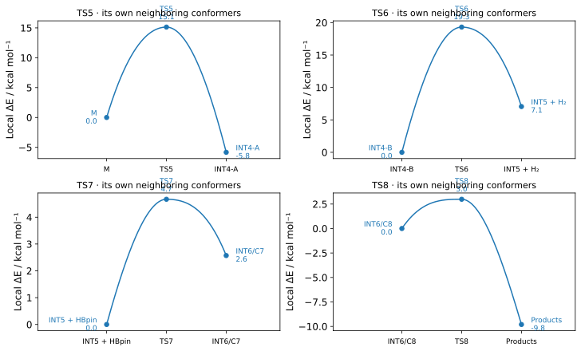

# Reviewing The Bisarylation Branch

The second-arylation branch needs its own structures and balanced energy
accounting. For example, H₂ leaves between INT4 and INT5, and HBpin enters the
exchange segment. Comparing those isolated structures without the missing
fragments would compare different atom inventories.

| Saddle | Forward reference | Reverse reference |
| --- | --- | --- |
| TS5, second C–H activation | Monoaryl catalyst + incoming substrate | INT4 adduct |
| TS6, H₂ elimination | INT4 | INT5 + H₂ |
| TS7, two-saddle bridge entry | INT5 + HBpin | INT6 |
| TS8, two-saddle bridge exit | INT6 | Monoaryl catalyst + arylBpin |
| Direct TS7-only or TS8-only hypothesis (unvalidated) | INT5 + HBpin | Monoaryl catalyst + arylBpin |

FRUST cancels common spectators before evaluating a local barrier. Thus the
TS6 forward barrier needs its saddle and INT4, while the TS7 entry barrier also
needs HBpin. A missing dimer reference does not hide a qualified local barrier.
Dimer-referenced saddle elevations remain separate columns with their own quality.

!!! warning "Geometry references and mechanism assignment are separate"

    Reviewed UMA gas references for TS5–TS8 and INT4–INT6 are selectable as
    immutable revision 2. Native reconstruction, regeneration and transferred
    local connections were reviewed before publication. Scientific examples
    establish two-saddle exchange. Direct TS7-only and TS8-only chemistry remains
    unvalidated; software support for those hypotheses is not chemical proof.
    Every new system keeps an unresolved mechanism until its own evidence is reviewed.

## Construct And Calculate

Start from an expanded system table, as for an ordinary catalyst screen:

| system_name | substrate_smiles | catalyst_smiles | rpos |
| --- | --- | --- | ---: |
| pyrrole_TMP | `CN1C=CC=C1` | `CC1(C)CCCC(C)(C)N1c1ccccc1B` | 2 |

By default the initially bound aryl uses the same substrate and site. Add
`bound_substrate_smiles` and `bound_rpos` when they differ.

The following assumes `systems` is that table. UMA gas uses the published
references directly. For a DFT final method, explicitly choose the UMA geometry
profile if those are the intended starting guesses; this does not supply a DFT
reference. See [geometry-profile maintenance](../development/ts-spec-profiles.md).

```python
import frust as ft

wf = ft.workflows.catalyst_screen(
    ts_types=["TS5", "TS6", "TS7", "TS8"], scope="full_cycle",
    systems=systems,
    method="uma-gas",
    screening="uma-gas",
    spec_profile="uma-gas",
    n_confs=8,
    validation_top_n=3,
)
wf.plan()
run = wf.run(out_dir="runs/bisaryl", n_cores=4, mem_gb=16)
```

`plan()` inspects targets without embedding structures or running calculators.
Local execution and cluster submission use the same native target definitions.
All three retained candidates receive requested full characterization. The
same contract applies to capable DFT final plans with an explicitly selected
guess profile. Optional ranking uses the ordinary shared method-plan policy.

Racemic dimer pairing is currently unsupported by this composed workflow; supplied
catalyst configurations and the shared stereoisomer-expansion policy are supported.

## Review Results Before Assigning A Route

Inspect modes and minimum identities first:

```python
run.review_queue()
run.states()[["state_id", "cid", "result_id", "quality_status"]]
```

Use `set_review` for a TS mode or `set_identity_review` for a minimum after
inspecting its chemistry. Approval never overrides failed convergence or
vibration checks. INT4, INT5 and INT6 require explicit identity review.

Then inspect the candidates for a particular route hypothesis:

```python
pool = run.pathway_candidates(
    system_name="pyrrole_TMP", rpos=2, variant="two_saddle"
)
pool[["role", "cid", "result_id", "quality_status", "selected"]]
```

The helper lists every applicable role and candidate, including failed or missing
choices. It does not pick a mechanism. Select the chemically qualified rows using
the actual paths, endpoint minima and source bindings. A resolved decision needs
saved evidence and exact result IDs for each required role:

```python
# reviewed_pool contains one explicitly reviewed result for each required role.
chosen = reviewed_pool.set_index("role")["result_id"].to_dict()
run.set_pathway_review(
    system_name="pyrrole_TMP",
    rpos=2,
    variant="two_saddle",
    result_ids=chosen,
    evidence_files=["reviewed_paths_and_minima.json"],
    note="Both exchange saddles and their adjacent minima were checked.",
)
```

| Variant | Meaning | Exchange states omitted from analysis |
| --- | --- | --- |
| `two_saddle` | TS7 → INT6 → TS8 with reviewed local connections | None |
| `ts7_only` | One directly connecting exchange saddle assigned TS7 | INT6 and TS8 |
| `ts8_only` | One directly connecting exchange saddle assigned TS8 | TS7 and INT6 |
| `unresolved` | No supported complete assignment yet | None implied absent |

Raw calculated candidates remain retained after a route decision. Unused branches
are omitted from that route's profile and barrier tables. A planning hypothesis
does not approve newly calculated rows. Approved prior hypotheses can be reused via
`run.pathway_reviews().attrs["frust_pathway_reviews"]`, but the next run still needs
result-bound review.

Evidence files are copied into the portable run. Changed results, revoked identity
approval, a different method or changed/missing proof files invalidate the decision.
Use `variant="unresolved"` with empty bindings to withdraw a decision explicitly.

## Keep Neighboring Conformers Explicit

TS7 and TS8 can reach chemically identical bridge minima in different conformers.
Bind each saddle's actual neighbor when their result IDs differ:

```python
run.set_pathway_review(
    system_name="pyrrole_TMP", rpos=2, variant="two_saddle",
    result_ids=chosen,
    minimum_result_ids={"TS8": {"INT6": bridge_from_TS8}},
    evidence_files=["reviewed_paths_and_minima.json"],
    note="TS7 and TS8 reach distinct bridge conformers; interconversion is unresolved.",
)
```

The TS8 local barrier now uses that specific minimum. The ordered ledger still uses
its explicitly selected INT6 row. `reference_result_ids`, `product_result_ids` and
`uses_alternate_minimum` expose the distinction in the barrier table. This does not
establish an interconversion barrier or a continuous kinetic path.

## Inspect Local Barriers And The Balanced Ledger

```python
run.barriers()[[
    "ts_type", "reference_state", "delta_g_kcal_mol",
    "reverse_delta_g_kcal_mol", "quality_status",
]]
run.candidate_barriers()
run.profile(quantity="electronic", include_invalid=True)
run.pathway_reviews()
```

`candidate_barriers()` retains every TS result. An alternative exchange saddle
does not inherit the selected candidate's path approval. A recorded dimer choice
can be changed in memory to another available calculated topology through
`profile(dimer_reference="dimer_eight_membered")`.

| Quality | Interpretation |
| --- | --- |
| `ready` | Required numerical, identity and applicable review checks pass |
| `review` | Scientific review or a current pathway decision is still needed |
| `invalid` | Numerical, identity, composition or protocol checks fail |
| `incomplete` | A required result or energy is missing |

Forward, reverse and dimer-elevation quality are separate. A reverse minimum may
be missing even when the forward local barrier is available. Unresolved exchange
energies are withheld. A balanced electronic ledger alone does not establish
selectivity, solvent effects or concentration-dependent rates.


## Worked Native Reference: Local Barriers And Escape

The reviewed TMP/1-methylpyrrole calculations give the following local barriers.
Each saddle uses its actual neighboring minimum or free-fragment reference.
Common spectators cancel before subtraction.

| Saddle | Forward starting state | Forward ΔE‡ | Forward ΔG‡ | Reverse ΔE‡ | Dimer-referenced saddle ΔE |
| --- | --- | ---: | ---: | ---: | ---: |
| TS5 | Free monoaryl + substrate | 15.126 | 29.717 | 20.957 | 19.856 |
| TS6 | INT4-B | 19.310 | 15.141 | 12.252 | 16.627 |
| TS7 | Free INT5 + HBpin | 4.668 | 21.503 | 2.098 | 9.042 |
| TS8 | INT6/C8 | 2.988 | 1.817 | 12.791 | 13.149 |

All values are kcal/mol. Gas UMA-S 1.2.1; Gibbs thermochemistry is at 298.15 K
and 1 atm. No solvent, concentration or empirical association correction is
applied. Dimer-referenced saddle elevations use the lowest reviewed matched
dimer, with half a dimer and the required spectators. They measure a different
energy difference from a local activation barrier.



For example, TS7's reverse electronic barrier is 2.098 kcal/mol from INT6/C7;
TS8's forward barrier is 2.988 kcal/mol from INT6/C8. C8 lies 3.217 kcal/mol above
C7 electronically. These are local escape barriers from different conformers.
Their competition from one equilibrated intermediate would additionally require
conformer-interconversion evidence and relevant conditions. Do not substitute
one minimum into both barriers or use a productive-cycle cutoff to infer
side-reaction selectivity.

The figure follows this native plotting call, repeated for each row of the
[exact input table](../assets/bisarylation/local-barriers.csv):

```python
import frust as ft

# TS8 and its exact neighboring bridge/product conformers; local electronic zero.
ft.plot_energy_profile(
    [("INT6/C8", 0.0), ("TS8", 2.987633), ("Products", -9.803614)],
    ylabel="Local ΔE / kcal mol⁻¹",
    show_state_labels=True,
)
```

The exact accepted reference structures are shown below. They were rebuilt from
chemical inputs and validated after release; these views display the saved
optimized coordinates, not fresh guesses.

<iframe src="../../assets/bisarylation/references.html" width="100%" height="610" title="Exact reviewed native TS5–TS8 reference structures" loading="lazy"></iframe>

New structures follow the same representation chain:
`SMILES → native embedded guesses → constrained preparation → released *-oc → frequencies and paths → reviewed results`.
A visible structure, successful optimizer exit or one imaginary frequency alone
is insufficient for chemical approval.

## Coverage And Production Readiness

Two-saddle local exchange is validated in the TMP reference and additional
NMe₂/DMB and NMe₂/DMT examples. The independent six-system piperidine/NEt₂ panel
retains 72 candidates: 61 converged intended modes, 10 excluded native caps and
one unresolved weak mode. Transferred local connections exist for every TS
family, across two panel systems. This does not assign a complete mechanism to
every tested system or certify unseen targets.

Direct single-saddle chemistry, complete per-target mechanisms, conformer
interconversion and side-reaction selectivity remain unvalidated. The workflow
keeps those distinctions visible. The development readiness assessment records
all 22 shortlisted combinations and 17 configurations; none is certified to
avoid bisarylation. A production campaign must review its own candidates,
applicable states and paths. Mixed R/S dimer pairing is also unavailable in this
composed factory; same-configuration pairing is supported.

A practical starting validation allocation is eight guesses and three
characterized candidates per saddle, with bounded jobs on four Mac CPU threads
or eight CPU threads/16 GiB and a GPU on the validated backup host. Measured
native saddle searches for the smaller additional systems took roughly
13–18 minutes per family on the GPU; endpoint characterization and recovery can
dominate total time. These observations are planning inputs, not an ETA for a
larger catalyst. Missing or unreviewed target states remain explicit limitations.

The [reaction-coverage guide](reaction-coverage.md) explains the unified planner,
partial selections, mixed branches and exact connection reviews.
