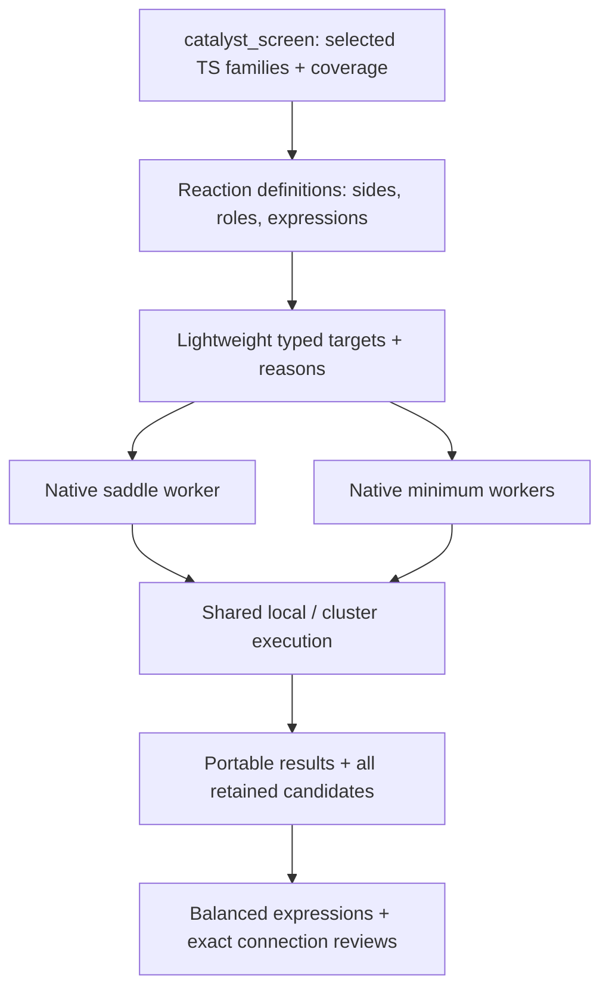

# Choose reactions, then choose coverage

```python
import frust as ft

wf = ft.workflows.catalyst_screen(
    systems=systems,
    ts_types=["TS1", "TS2", "TS3", "TS4", "TS5", "TS6", "TS7", "TS8"],
    scope="full_cycle",
    method="uma-gas", screening="uma-gas",
    n_confs=8, validation_top_n=3,
)
wf.plan()[["branch", "state_id", "options"]]
```

`ts_types` chooses the reactions to investigate. `scope` chooses how much of
those reactions to calculate. Planning inspects chemical inputs and available
geometry profiles; it does not embed structures or start calculators.

| Request | Planned coverage |
| --- | --- |
| TS1–TS4, `barriers` | Productive barrier equations and the established reference pool |
| TS1–TS4, `full_cycle` | Productive minima, products and balanced references; no INT4–INT6 |
| TS5–TS8, `full_cycle` | Second-arylation minima and references; no automatic TS1–TS4 |
| TS6, `barriers` | TS6 and INT4 |
| TS6, `full_cycle` | TS6, INT4, INT5 and H₂ |
| TS1–TS8, `full_cycle` | Both named branches, with identical calculations reused |

Productive `full_cycle` retains its established minimum/reference coverage even
for a partial productive TS selection. It does not add unrequested saddles.
Partial second-arylation selections follow only their declared expression inputs.
Empty and unknown TS selections raise before construction or submission.



Structure builders construct geometries from chemical roles. Reaction definitions
supply dependencies and stoichiometry. Method plans supply calculators. Changing
UMA to a supported DFT plan preserves the selected chemistry and validation-count
contract; available geometry profiles and calculator capabilities are checked
separately.

## Example: H₂ elimination

```python
wf = ft.workflows.catalyst_screen(
    systems=systems, ts_types=["TS6"], scope="full_cycle",
    method="uma-gas", screening="uma-gas",
)
```

| Quantity | Electronic expression |
| --- | --- |
| Forward barrier | E(TS6) − E(INT4) |
| Reverse barrier | E(TS6) − E(INT5) − E(H₂) |
| Reaction energy | E(INT5) + E(H₂) − E(INT4) |

The same coefficients apply to Gibbs quantities when thermochemistry is available.
H₂ is needed for the reverse barrier; its absence does not invalidate the forward
barrier. Canceled spectators are removed before checking a quantity's inputs.
Every expression checks actual atom inventories and compatible energy protocols.

`validation_top_n=3` and `ranking_top_n=3` both request up to three final candidates,
with or without an explicit ranking plan. Conflicting explicit aliases raise.
`top_n` remains the earlier screening cutoff. Retained candidates undergo all
requested characterization stages; final quality and energy select the winner.

## Inspect branches and connections

```python
run = ft.screen.open_run("runs/mixed-screen")
run.barriers()                    # Selected quantities with quality status
run.candidate_barriers()          # Includes rejected and unresolved candidates
run.profile(network_id="productive")
run.profile(network_id="bisarylation")
run.connection_reviews()          # Exact connection status and reference bindings
```

A mixed profile table identifies its `network_id`; plotting requires selecting
one branch. It never joins TS1 through TS8 into a fictitious serial mechanism.
Partial selections show local reaction profiles rather than filling absent saddles.

A numerical saddle and a thermodynamic energy comparison do not by themselves
establish a chemical connection. For a reviewed connection, bind the saddle,
independently optimized endpoints and the exact energy-reference conformers:

```python
run.set_connection_review(
    system_name="pyrrole__TMP", rpos=2,
    reaction_id="bisarylation.ts6",
    saddle_result_id=ts6_result,
    reference_result_ids={"INT4": int4_result, "INT5": int5_result, "HH": h2_result},
    endpoint_result_ids={"INT4": reactant_endpoint, "INT5": product_endpoint},
    direction_sides={"forward": "reactants", "backward": "products"},
    evidence_files=["reviewed-ts6-connection.json"],
    note="Document the associated endpoint and separate-fragment convention here.",
)
```

The two IRC direction names need not correspond to a fixed chemical side.
An associated endpoint and separate optimized fragments are distinct records;
state their relationship in the evidence and note. The method checks exact
result ownership, numerical/identity qualification, protocol and proof hashes.
The reviewer must inspect the actual chemistry. A replacement saddle or changed
endpoint, reference, method, decision or proof invalidates that connection.
An alternative candidate cannot inherit the selected saddle's neighbor approval.
Unrelated connections remain independent.

| Connection status | Meaning |
| --- | --- |
| `approved` | Exact saved results, protocol, definition and proof remain current |
| `unreviewed` | No connection decision is recorded |
| `unreviewed_candidate` | This candidate is not the saddle bound by the decision |
| `stale` / `stale_protocol` | Bound results, identity, definition, decision or protocol changed |
| `missing_protocol` / `incompatible_protocols` | Required protocol metadata is absent, or bound results use different protocols |
| `missing_saddle_binding` | A legacy neighbor override lacks its exact saddle |
| `missing_evidence` / `changed_evidence` | Saved proof is missing or its digest changed |

Existing productive thermodynamic comparisons remain available without requiring
new IRCs. Flagged diagnostic values retain their quality status and cannot become
an approved connection. Second-arylation exchange quantities still require their
own current scientific review.

!!! warning "Selection is not mechanism proof"
    Selecting TS7 alone does not establish a direct TS7-only mechanism. An omitted
    state is **not requested**. A proven alternative may make it **inapplicable**.
    Untested alternatives remain **discovery/unresolved**; required results can be
    **missing** or **invalid**. Reviewed two-saddle examples do not validate direct
    TS7-only or TS8-only chemistry for another system.

`bisarylation_screen(...)` remains a convenience wrapper selecting TS5–TS8 and
full-cycle coverage through the same coordinator. Historical portable runs remain
readable through their original bindings and schemas; reading them does not
rewrite result IDs, raw files or evidence hashes.
