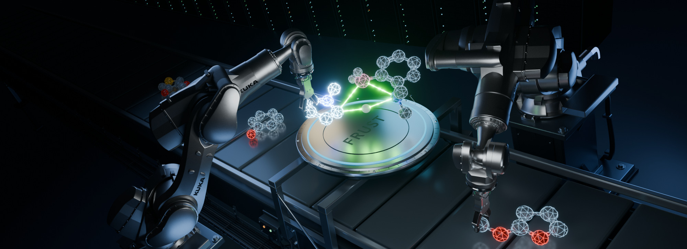

# FRUST Documentation



*3D artwork created in Blender illustrating automated FLP transition-state screening on HPC — accompanying our Edge Article in Chemical Science (2026):* [10.1039/d6sc04421b](https://doi.org/10.1039/d6sc04421b).

**FRUST** automates computational catalyst optimization, substrate screening, and full-cycle mechanistic analysis for **frustrated Lewis pair (FLP)-catalyzed C–H borylation**. Starting from candidate B–aryl–N FLP catalyst and substrate SMILES, it discovers symmetry-unique C–H sites, constructs constrained 3D transition-state guesses (`tsguess2` across `TS1`–`TS8`), executes composable `xTB` / `g-xTB` / Meta `UMA` / `ORCA` workflows locally or on Slurm clusters, and produces compact Parquet result bundles for resting-state dimer, barrier (`ΔG‡`), and side-reaction evaluation.


## Quick Example

Compose conformer screening, UMA reranking, reusable catalyst-dimer / reagent references, and final barrier validation in one workflow object:


```python
import frust as ft

wf = ft.workflows.catalyst_screen(
    csv_path="docs/examples/screen.csv",
    screening="gxtb-default",
    ranking="uma-alpb-chloroform",
    ranking_top_n=3,
    method="uma-gas-opt-alpb-chloroform",  # or "wb97xd3-631g" for ORCA DFT
    level="full",
    scope="barriers",
)

wf.plan()
```

!!! note "Active research software"

    FRUST workflows are tested and documented for active FLP catalyst design and mechanistic research, though APIs and defaults may still evolve as models and workflows are refined.

## Start Here

- [Installation](getting-started/installation.md) covers basic Python package setup and optional extras.
- [External tool setup](getting-started/external-tool-setup.md) covers `.env`, xTB, ORCA, ORCA-External-Tools, UMA prerequisites, and g-xTB paths.
- [Quickstart](getting-started/quickstart.md) shows the shortest practical workflow and `Stepper` entry points.
- [End-to-end catalyst-screen tutorial](tutorials/end-to-end-catalyst-screen.md) walks from `screen.csv` through reference calculations, vibration review, and portable barrier bundles.
- [UMA method choices](catalyst-screens/uma-screening.md) compares hybrid `g-xTB -> UMA` and `UMA -> ωB97X-D3` plans alongside full-cycle UMA characterization.
- [Reaction coverage](catalyst-screens/reaction-coverage.md), [Bisarylation review](catalyst-screens/bisarylation.md), and [Catalyst stereochemistry](development/catalyst-stereochemistry.md) cover `TS1`–`TS8` pathway planning, stereoisomers, and off-cycle branch analysis.
- [TS guess dataframes](catalyst-screens/ts-guesses.md) explains how the `tsguess2` backend turns systems and reactive positions into self-describing constrained TS rows.
- [Inspecting results](workflows/inspecting-results.md) and [Visualization overview](visualization/overview.md) cover 2D site grids, interactive 3D conformers/vibrations, and energy profiles.
- [Troubleshooting failed calculations](troubleshooting/failed-calculations.md) starts from `*-NT`, `*-error`, and saved backend files.

## External Tools

FRUST does not install external quantum chemistry engines automatically. Configure the backends required by your workflow in the execution environment:

- **ORCA** and **xTB** for standard DFT (`wb97xd3-631g`) and semiempirical calculations.
- **ORCA-External-Tools** for Meta **UMA** and ORCA-driven **g-xTB**.
- **g-xTB** executable for direct and ORCA-driven semiempirical stages.
- **prism-pruner** for initial conformer deduplication before `xTB` stages.

Start with [External tool setup](getting-started/external-tool-setup.md), then see the [UMA](external-tools/uma.md) and [g-xTB](external-tools/gxtb.md) pages for method-specific details.

## API Reference

The [API reference](api/top-level.md) documents the public surface most users touch directly: the curated `ft` namespace, `ft.workflows`, `ft.screen`, `ft.tsguess2`, `Stepper`, visualization helpers (`ft.vis`), cluster submission (`ft.cluster`), and dataframe schema utilities.
