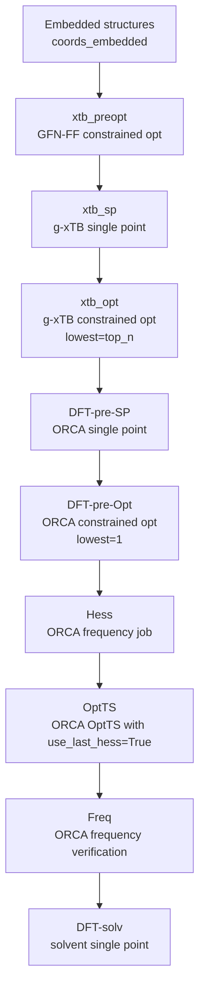

# Optimization Pipeline

FRUST calculation stages are chained through a dataframe. Each stage reads the
latest available coordinate column, runs a backend calculation, and adds
stage-prefixed output columns such as `xtb_opt-NT`, `xtb_opt-EE`, and
`xtb_opt-oc`.



This diagram matches the transition-state stage graph used by
`ft.workflows.screen_ts(...)`. The workflow object applies the same graph for
local and submitted execution.

For `ft.workflows.screen_ts(...)`, an `initial_prune` stage runs by default
between embedded TS guesses and `xtb_preopt`. It removes geometrically
redundant conformers before the first calculator stage.

!!! tip "Cheap broad, expensive narrow"

    The normal screening pattern is to generate many conformers, optimize them
    cheaply, keep only the lowest few, and then spend DFT time on the best
    candidates.

## Stepper Pattern

At the `Stepper` layer, the pipeline is explicit:

```python
df = step.xtb(
    df,
    name="xtb_opt",
    options={"gfn": 2, "opt": None},
    constraint=True,
    lowest=5,
)

df = step.orca(
    df,
    name="orca_sp",
    options={"r2scan-3c": None, "SP": None},
)
```

`Stepper` chooses the latest coordinate column automatically. For example, an
ORCA stage after `xtb_opt` will use `xtb_opt-oc` rather than the original
`coords_embedded`.

For an allocation of eight cores, run eight independent xTB rows at once:

```python
import frust as ft

step = ft.Stepper(n_cores=1, n_workers=8)
df = step.xtb(df, name="xtb_opt", options={"gfn": 2, "opt": None})
ft.show_steps(df)[["n_cores", "n_workers", "input_rows", "output_rows"]]
```

`n_cores` is the core count per row; `n_workers` is the maximum number of rows
running together. Each calculator call can override either value. `Stepper`
defaults to one worker, preserves input row order, and records failed rows in
`*-NT` and `*-error`. Concurrent ORCA clients share the Stepper memory budget
equally. Workflow objects choose stage concurrency automatically.

To remove optimized duplicates only when their energies also agree:

```python
df = step.prune_conformers(
    df,
    name="optimized_prune",
    modes=("moi",),
    coords_col="xtb_opt-oc",
    energy_col="xtb_opt-EE",
    moi_max_deviation=0.005,
    max_dE=0.05 / 627.5095,
)
```

`max_dE` uses the units of `energy_col`: the example converts 0.05 kcal/mol to
Hartree. Both the energy and geometry criteria must match before a row is
removed. The lowest-energy representative survives. Omitting `max_dE` retains
the usual geometry-only pruning behavior.

## TS Workflow Stages

Staged workflow submission writes a new parquet file after each major group:

| Stage | Main purpose | Output suffix |
| --- | --- | --- |
| `run_init` | embed, xTB cleanup, constrained DFT pre-optimization | `init.parquet` |
| `run_hess` | calculate an ORCA Hessian for the best rows | `.hess.parquet` |
| `run_OptTS` | run ORCA `OptTS` with `use_last_hess=True` | `.optts.parquet` |
| `run_freq` | verify the optimized stationary point | `.freq.parquet` |
| `run_solv` | run solvent single points | `.solv.parquet` |
| `run_cleanup` | remove intermediate parquet files | keeps deepest output |

!!! warning "Frequency method depends on the backend"

    Standard ORCA DFT frequency stages use `Freq`. ORCA-driven g-xTB uses an
    external-gradient route, so use `NumFreq` for finite-difference
    frequencies. See [g-xTB With FRUST](../external-tools/gxtb.md).

## When To Use g-xTB Or UMA

Use direct `Stepper.gxtb(...)` for ordinary g-xTB single points,
optimizations, gradients, or Hessians.

Use `Stepper.orca(..., gxtb=True)` when ORCA should own the optimizer, such as
`OptTS`, while g-xTB supplies external energies and gradients.

Use `Stepper.orca(..., uma=...)` for UMA-backed ORCA external calculations.
The same dataframe conventions still apply: inspect `*-NT`, `*-EE`, `*-oc`,
`*-vibs`, and `*-error` columns after each stage.
